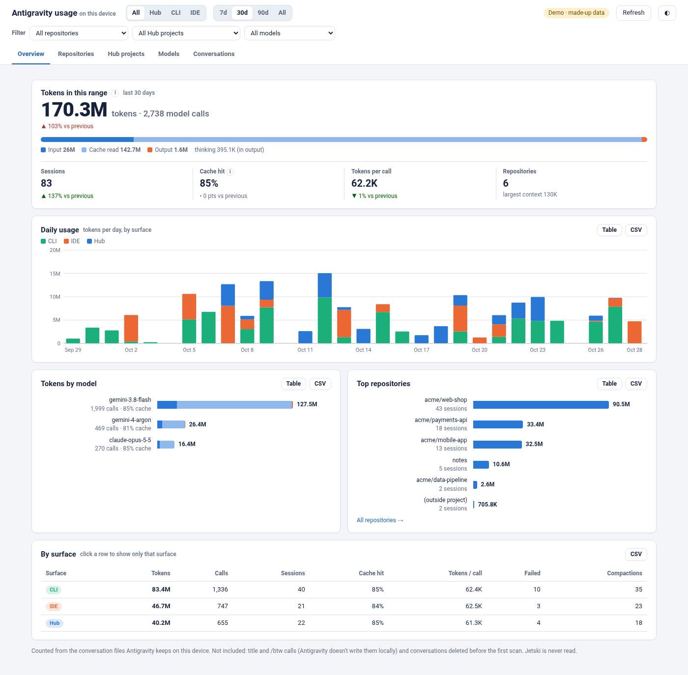
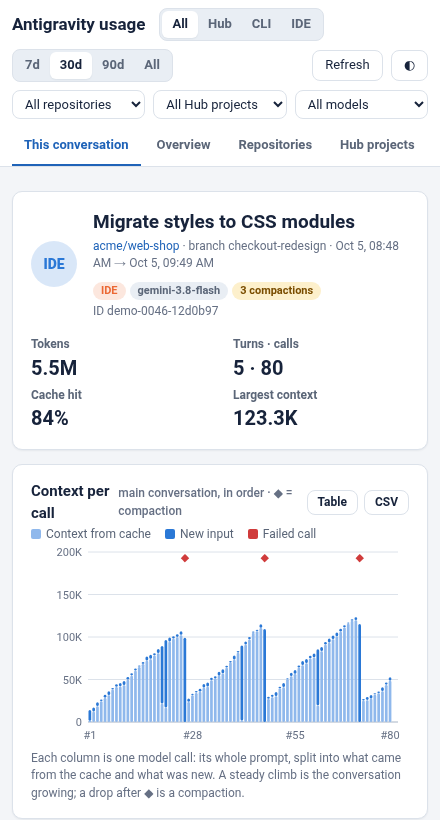
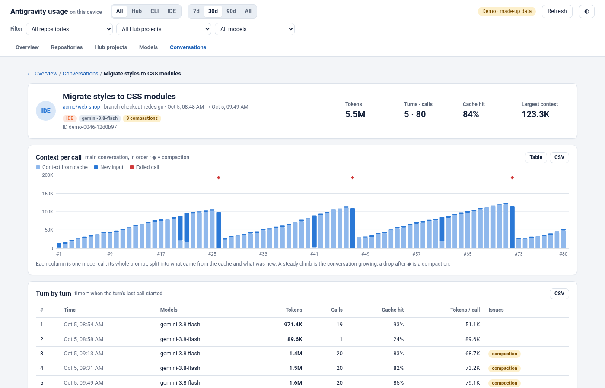

# agy-local-telemetry

Token usage for Google Antigravity, broken down by project, model and conversation. It runs locally, and no data leaves your computer.



*The overview page. All screenshots in this document use demo data.*

## Overview

Antigravity stores a record of each conversation on your computer, including which AI model answered and how many **tokens** it used. Tokens are the unit in which AI usage is measured; one token is roughly three quarters of a word.

**agy-local-telemetry** reads these records and presents:

- **Usage over time:** today, this week or this month, compared with the previous period.
- **Breakdown:** by project (git repository), by Antigravity application and by AI model.
- **Inside a conversation:** turn by turn and call by call, to show why a long conversation used more.
- **Answers in Antigravity:** ask *"How many tokens did I use this week?"* and Antigravity looks it up.

It covers all three Antigravity applications:

| Application | Shown as |
|---|---|
| Antigravity 2.0 (the desktop app, also called the Hub) | **Hub** |
| Antigravity in the terminal (`agy`) | **CLI** |
| Antigravity inside your code editor (e.g. VS Code) | **IDE** |

## Privacy

- **Nothing leaves your computer.** No internet connection, account or sign-in is needed.
- **It only reads.** It never changes or deletes anything Antigravity keeps.
- **It does not read what you wrote.** It uses counts (tokens, calls, times) and names (projects, models, conversation titles) only.
- **It does not call any AI model** and costs nothing to run.

## Installation

### What you need

1. **Antigravity**, already installed and working.
2. **Node.js 22.5 or newer.** Node.js is a free runtime that this tool uses. To check your version, open a terminal and run:
   ```bash
   node --version
   ```
   Version `v22.5.0` or higher (for example `v22.22.2` or `v24.1.0`) is sufficient. If the version is lower, or the command is not found, install the current LTS release from [nodejs.org](https://nodejs.org). On macOS with Homebrew, `brew install node` also works.

3. **A copy of this repository.** Download it (**Code** → **Download ZIP**, then unzip) or use `git clone`.

> [!NOTE]
> Tested on Linux; macOS is expected to work the same way. Windows is not supported yet.

### Option A: ask Antigravity to install it

Open Antigravity (the `agy` terminal app or the Hub) and send the following message, replacing the placeholder with the location of the downloaded folder:

```text
Please install the agy-local-telemetry plugin from <the folder you downloaded>/agy-local-telemetry.
Follow the steps in its INSTALL.md.
```

Antigravity checks the Node.js version, installs the plugin, runs a first report and confirms when it has finished. Approve its commands when it asks for permission.

### Option B: install it manually

Open a terminal in the downloaded folder and run:

```bash
agy plugin install "$PWD/agy-local-telemetry"
```

The output confirms `skills : 1 installed (agy-local-telemetry)`.

### After installing

- Restart the Antigravity Hub if it was open, and start a new `agy` session, so that both load the plugin.
- To preview the page before installing, see [Demo data](#demo-data).

## Usage

### 1. In the Antigravity Hub

Open a conversation, select the **plugins (+)** menu at the top and choose **Usage**. A side panel opens on the current conversation, showing its tokens, models and individual calls. The other tabs cover all usage on this computer.



### 2. Ask Antigravity

In `agy` or the Hub, ask questions such as:

- *"How many tokens did I use this week?"*
- *"Which of my projects used the most tokens this month?"*
- *"Which models do I use the most?"*
- *"How many tokens has this conversation used so far?"*
- *"Open my usage page."*

Antigravity answers using the plugin's skill, which reads the recorded figures.

### 3. In your web browser

Ask Antigravity to *"open my usage page"*, or run the following in a terminal:

```bash
~/.gemini/config/plugins/agy-local-telemetry/bin/agy-local-telemetry serve
```

Then open **http://localhost:8086**. The page runs while the terminal stays open; press **Ctrl + C** to stop it.

## The page

| Element | Purpose |
|---|---|
| **All / Hub / CLI / IDE** (top) | Show one Antigravity app, or all of them |
| **7d / 30d / 90d / All** (top) | The time period |
| **Filter** (second row) | Narrow everything to one project, Hub project or model. Remove a filter with **×** |
| **Overview** | The big picture: total tokens, how they split, daily usage, top models and projects |
| **Repositories** / **Hub projects** / **Models** | Ranked lists. **Click any row** for its own page |
| **Conversations** | Every conversation, with search and quick views: most tokens, with failures, ran out of space, low cache use |
| **Refresh** (top right) | Reads the newest conversations. The page also does this when it opens |

Each chart has a **Table** button that shows its figures, and each table has a **CSV** button for spreadsheet export. Select a column heading to sort. The **◐** button switches between light and dark themes.

Selecting a conversation shows it turn by turn:



## Terms

| Word | Meaning |
|---|---|
| **Token** | The unit AI usage is counted in, roughly ¾ of a word. Everything sent to and from the model is counted in tokens |
| **Input** | New text sent to the model in a call: your message, files the agent read, tool results |
| **Cache read** | Text the model had already seen earlier in the conversation and re-read from memory. Much cheaper and faster than new input |
| **Output** | What the model wrote back, including its "thinking" |
| **Total** | Input + cache read + output |
| **Cache hit** | The share of what the model read that came from memory. **Higher is better:** long conversations often reach 80–90% |
| **Call** | One request to the AI model. One question from you can lead to many calls while the agent works |
| **Turn** | One message from you and everything the agent did to answer it |
| **Session** | One conversation, including any helper agents it started |
| **Context** | Everything the model has to read on a call. It grows as a conversation gets longer |
| **Compaction** (◆) | When a conversation gets too long, Antigravity summarises it to make room. The next call starts with less in memory |
| **Repository** | The project folder (git repository) the conversation worked in |
| **Hub project** | A group of conversations in the Antigravity Hub |

## Frequently asked questions

**The page is empty or shows "Nothing in this range".**
Select a longer period (**90d** or **All**). Only conversations still stored on this computer can be shown, so a new computer starts empty.

**Why do the figures differ from my bill or my organisation's dashboard?**
This is a usage meter, not a bill:
- It counts tokens, not money. Charges depend on your plan.
- It covers **this computer** only.
- A few small background calls are not stored locally (for example, the call that writes a conversation's title).

An organisation-wide dashboard, where available, includes every computer and those background calls.

**Does it slow Antigravity down?**
No. It reads Antigravity's files only when the page opens, when Refresh is pressed, or when usage is requested; this takes a second or two. In the Hub, the panel's helper process stays idle in between.

**Can it show other people's usage?**
No. It covers this computer only.

**Where is the usage history kept, and how is it deleted?**
In `~/.local/share/agy-local-telemetry/`. Deleting that folder clears it. It is rebuilt from Antigravity's files on next use, except for conversations Antigravity has since deleted.

**Can I preview it first?**
Yes, with demo data (see below).

## Demo data

From the downloaded folder:

```bash
./agy-local-telemetry/bin/agy-local-telemetry demo
```

Then open **http://localhost:8087**. All figures are fictional, and your own usage is not read. Press **Ctrl + C** to stop.

## Troubleshooting

| Symptom | Resolution |
|---|---|
| `node: command not found`, or a version below 22.5 | Install the Node.js LTS release from [nodejs.org](https://nodejs.org), then retry |
| **Usage** is missing from the Hub's plugins (+) menu | Restart the Hub, then run `agy plugin list`; `agy-local-telemetry` should be listed as *enabled*. If it is disabled, run `agy plugin enable agy-local-telemetry` |
| Antigravity does not use the plugin when asked about usage | Start a new conversation; skills load when a conversation starts |
| The browser cannot connect to localhost:8086 | The page runs only while its terminal is open. Start it again with the `serve` command above |
| "can't write … using a temporary record" | Expected where the history folder cannot be written (for example, inside an agent's sandbox). The figures are rebuilt on the spot and are identical |
| Figures look wrong after an Antigravity update | Antigravity's local file format is not documented and can change. Please report the issue |

## Updating and removing

- **Update:** download the latest version (or run `git pull`), then install again:
  ```bash
  agy plugin install "$PWD/agy-local-telemetry"
  ```
- **Remove:**
  ```bash
  agy plugin uninstall agy-local-telemetry
  ```
  The usage history remains in `~/.local/share/agy-local-telemetry/` until deleted.

<details>
<summary><b>Technical details</b></summary>

### How it works

1. **Finds** Antigravity's data folders under `~/.gemini/`: `antigravity` (Hub), `antigravity-cli` (CLI), and any other `antigravity-<app>` folder that holds a `conversations/` folder. Nothing else under `~/.gemini` is opened.
2. **Reads** each changed conversation database (SQLite) from a private copy, so nothing is ever written beside Antigravity's files:
   - `gen_metadata`: one row per model call (tokens, model, turn, error).
   - `steps`: per-call start times, turns and compactions.
   - `trajectory_metadata_blob`: workspace folders, git root/remote/branch, subagent → parent.
   - `conversation_summaries.db`: the Hub project and the title.

   The format is undocumented (schemaless protobuf; see `lib/agy.mjs`). Token counts were checked against the totals agy prints itself: they match exactly.
3. **Keeps** each call once in `~/.local/share/agy-local-telemetry/record.sqlite`. `AGY_LOCAL_TELEMETRY_STORE` moves it. Calls stay even if Antigravity later deletes or rewinds them. If that folder can't be written, a temporary record is rebuilt instead.
4. **Reports** on request: by repository (git remote, else git root, else folder), Hub project, model, day and session. Nothing is precomputed.

### Command line

```text
agy-local-telemetry folders                 Antigravity data folders found on this computer
agy-local-telemetry scan                    read new and changed conversations
agy-local-telemetry report [--days N] [--by repo|surface|model|day|conversation|project] [--json]
agy-local-telemetry serve [--port 8086]     the page (127.0.0.1; HOST=0.0.0.0 for other machines, no login)
agy-local-telemetry demo  [--port 8087]     the page with made-up data
```

Needs Node 22.5+ (built-in `node:sqlite`). No dependencies, no build step.

### What's in the folder

```text
agy-local-telemetry/              the plugin (agy plugin install takes this folder)
├── plugin.json, assets/          plugin manifest and logo
├── INSTALL.md                    install steps written for agents
├── skills/agy-local-telemetry/   the skill: answering usage questions, page, update, uninstall
├── sidecars/agy-local-telemetry/ the Hub side panel (Sidecar SDK, provided by the Hub)
├── bin/agy-local-telemetry       the command
├── cli.mjs, lib/                 reading Antigravity's files, the record, reports, the page's API, demo data
├── ui/index.html                 the page (no external resources; uses the Hub's theme inside the Hub)
└── docs/                         pictures for this README (demo data)
```

### Known limits

- Not saved locally by Antigravity, so not counted: conversation-title calls, `/btw` side questions, cache writes.
- Calls carry no time of their own. Each takes the start time of its matching model step (they line up one-to-one in 322 of 329 turns checked); otherwise its turn's latest step time.
- Hub projects have only an ID on the device. Each shows the repository most of its calls ran in.
- Calls rewound before the first scan are lost.
- No money figures. One computer only. Checked on Linux.

</details>
